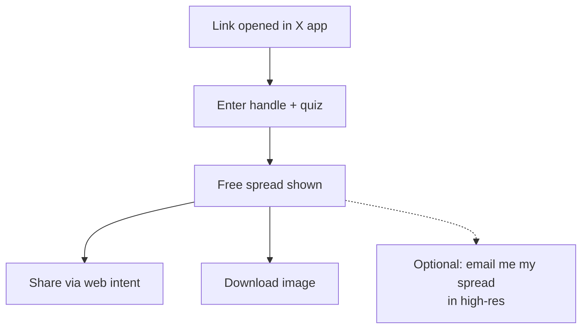
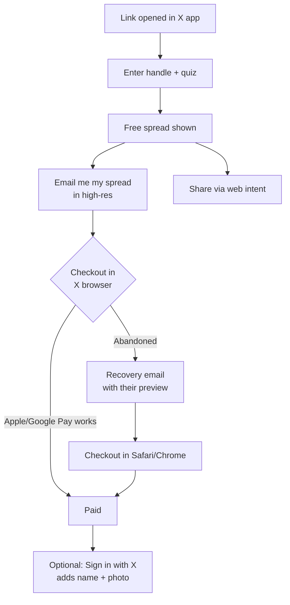

# Tweet Zine — Working Plan

Sep 23, 2026 · @Sonya Mann · last updated Nov 17, 2026 (rendering and hosting)

## Concept

A user enters an X handle, optionally answers three quiz questions, and gets a free two-page zine spread featuring their tweets, collaged with pre-curated public domain material. They can download or share the spread.

**Free first.** The free spread ships on its own, to find out whether people are interested. A paid 8-page zine was part of the original plan; all of that work is tabled until the free version is live and popular enough to justify it. The tabled material is kept at the end of this document, under "Tabled: paid zine".

Status: working plan, v0.3. Intended to become the product spec.

## Build status (Nov 17, 2026)

A prototype renders the free spread from a handle. Code and data are in the private repo `sonyamann/autozine`; see `README.md` for how to run it.

| Area | State |
| --- | --- |
| Free spread | Working prototype: fetch, filter, tag, match, lay out, render. Three layouts. Tested on 11 real accounts |
| Share images | Both sizes render |
| Image library | 1,681 images cleared for use, with source and license recorded; about 200 or more pickable in each theme |
| Text corpus | All sources downloaded, split into about 6,400 usable snippets, and theme-tagged |
| Tagging and matching | Jev, with cut-offs set from 82 hand-labeled tweets; keyword rules as fallback |
| Rendering | WeasyPrint: PDF and PNG, about 2 s per spread on the Mac. Checked against 25 Chrome renders. Not yet tried on the droplet |
| Web app (handle entry, quiz, share page) | Working locally: handle entry, quiz with emoji tokens, progress page, share page with PNG and PDF downloads and a link preview. Not deployed |
| Hosting, abuse and cost controls, legal pages | Not started |
| Quiz tokens | Emoji (decided Nov 19) |
| Original embellishments | Not started (original art) |
| Paid zine | Tabled |

## MVP scope

The MVP is the free spread, and it tests one question: do people like the output enough to make one and share it? Whether anyone would pay is a later question.

### Quiz

Two optional questions, each with "surprise me"; the whole quiz is skippable. The type is not asked (Nov 19): it's chosen from the tweets so the fonts are a surprise on the finished spread.

| # | Question | Options shown | Controls |
| --- | --- | --- | --- |
| 1 | Pick a token | 4 of 8, one per theme | Theme: library filter and matching bias. The token's emoji also leads the spread's header line (Nov 20); with "surprise me", one of the chosen theme's two tokens is picked by the seed |
| 2 | Pick an ink | 4 colors | Embellishments, type accents, backgrounds |
| (not asked) | Type | Jev picks one of 3 font pairings from the voice of the tweets: reflective or literary → bookish, dry or technical → machine, loud or showy → poster. Without Jev, the seed picks | Headline and body fonts (SIL Open Font License) |

**Inks (decided):** vermilion `#cf432b`, ultramarine `#2b40a3`, forest `#1e6b4b`, plum `#6c2b5d`.

**Font pairings (decided):**

| Pairing | Headline | Body | Mid-size tweet on ink |
| --- | --- | --- | --- |
| Bookish | Tapestry | EB Garamond | Tapestry |
| Machine | Space Mono Bold | Space Grotesk | Space Mono Bold |
| Poster | Rye | Work Sans | Zilla Slab Bold |

Some elements keep one font in every pairing so they read as fixed objects: the definition card and corpus quote (EB Garamond), the label-maker strip (Space Mono Bold), and small caps labels and credits (Space Grotesk).

| Theme | Tokens | Public domain sources |
| --- | --- | --- |
| Nature | Acorn, moth | Botanicals, animal engravings, landscapes |
| Domestic | Teacup, thimble | Household ads, tableware, interiors |
| High techne | Rocket, typewriter | Patent drawings, NASA imagery, diagrams |
| Cosmopolitan | Cocktail glass, steamer trunk | Pre-1931 travel posters, city photos, Art Deco ads |

Tokens are emoji (decided Nov 19, replacing the earlier plan for die-cast pewter art): 🌰 🦋 ☕ 🧵 🚀 ⌨️ 🍸 🧳. There is no perfume emoji, so a cocktail glass replaced the perfume bottle.

### Library and design assets

- About 50 public domain assets per theme (~200 total) was the original target. The library now holds 1,681 images. Pickable images per quiz theme: cosmopolitan 251, domestic 231, nature 213, high techne 199. Outside the quiz themes: ornament 615 (decorative pieces, tinted with the ink), folklore 94 (unused), and 78 set aside as too faint, too small or otherwise unusable.
- All four themes now have roughly 200 or more pickable images. Nature and cosmopolitan were filled out on Nov 17 from the Art Institute of Chicago, Cleveland, and the Library of Congress (Photochrom city views, WPA posters).
- **Open: folklore.** 94 remaining fairy-tale images (witches, gnomes, mermaids) fit none of the four themes. Add a fifth theme and token, or use them as wildcards.
- **Manifest:** `library/manifest.csv` has one row per image: theme, role, source, license, flags, and a written description. Images are sorted into theme folders; moving a file between folders reclassifies it.
- **Crops:** the manifest's `crop` column trims paper margins and mounts at render time (54 images so far); the files are untouched.
- **Legibility:** `small_ok` marks whether an image still reads at thumbnail size. Fine-line prints marked `no` are only used in the large slot. 38 faint drawings are flagged and never used.
- **Descriptions:** the 499 images eligible for matching (illustrations and silhouettes in the four quiz themes) each have a sentence covering subject, medium, and mood. Matching uses these, not the pictures.
- **Rights rules applied so far:** only sources that state public domain or CC0 status, or purchased clip-art packs licensed for commercial use. Images saved from X, museum images with non-commercial terms (Tate, the Morgan), and anything with an unverifiable source were removed.
- Photos keep their original color.
- 20–30 original single-color embellishments (tape, stamps, halftone, torn edges, arrows), tinted with the chosen ink. Not yet made: the prototype draws tape and halftone in code and tints public domain ornaments from the library.
- Attribute every asset, public domain included: title, author, source, license. A credit line on the spread, and a credits page on the site.
- Rough effort: 15–25 hours of curation plus design time (estimate).

**Recent image sources**

US government works and deliberate dedications supply modern-looking material.

| Source | Period | Best theme fit | Notes |
| --- | --- | --- | --- |
| DOCUMERICA (EPA, National Archives) | 1971–77 | Cosmopolitan, domestic | Strong 1970s color look |
| FSA/OWI color photos (Library of Congress) | 1939–44 | Domestic, cosmopolitan | Kodachrome slides |
| NASA, incl. Project Apollo Archive | 1960s–present | High techne | Hubble and Webb images often carry ESA credits under CC BY 4.0; check each credit line |
| US Fish & Wildlife, NOAA, National Park Service, USGS | 20th c.–present | Nature |  |
| Carol M. Highsmith Archive (Library of Congress) | 1980s–2020s | All | Contemporary photos donated without restrictions |
| Smithsonian Open Access | Various | All | CC0; includes 20th-century objects and design |
| Met, Art Institute of Chicago, Cleveland Museum of Art, National Gallery of Art | Mostly older | All | CC0 open-access scans |
| Nina Paley, *Sita Sings the Blues* | 2008 | Cosmopolitan | Believed CC0; verify current license |

Caution: state and local government works, and works by government contractors, are often not public domain.

### Text corpus

Core text sources beyond tweets: Sonya's vetted Kindle highlights and Bierce's *The Devil's Dictionary*.

- **Kindle highlights:** only from works published in the US through 1930. For translations, the translation itself must also be pre-1931. Done: 103 highlights from nine books (Eliot, Keats, Wharton, Conrad, Maugham, Mirrlees, London, Hughes), reviewed and theme-tagged. Translations and the Bible were left out.
- **Tag snippets** by theme, the same way as images. Done: Jev assigned each snippet one of the four themes or "general" (most are general). The Kindle highlights keep their hand-assigned themes.
- **Dropped without review:** 1,072 entries whose text mentions women, ethnicity, religion or disability (a keyword match, so some harmless ones went too). About 6,400 snippets remain usable.
- **Where it lives:** source texts in `corpus/texts/`; edition, source, and rights for each in `corpus/sources.csv`; all snippets in `corpus/snippets.csv`, rebuilt by `corpus/build_snippets.py`; hand decisions in `corpus/overrides.csv`.
- **UK rights:** Maugham, Mirrlees, Hughes, and Waley's *Pillow Book* are public domain in the US but still protected in the UK.

**Devil's Dictionary feature**

Match a word from the user's tweets to a Bierce headword and show his definition as a card beside the tweet, with the word highlighted.

1. Normalize tweet words to dictionary forms with a lemmatizer (e.g., spaCy).
2. Match against headwords; favor rarer words and higher-engagement tweets.
3. No good match: use the fallback card described under "Weak matches" below.

- **Source text:** the 1911 edition via Project Gutenberg (strip Gutenberg's header and license for commercial use). Avoid later enlarged editions.
- **Curated subset:** exclude entries with ethnic or sexist jabs.
- **Length limit:** use only entries under a word limit; never trim Bierce's text. Provisional limit: 45 words, and no entries with verse.
- **State:** 987 entries split out. 101 dropped (27 read and judged to be jabs, 74 longer ones dropped unread); about 560 eligible for cards.
- **Weak matches (decided):** a card needs a Jev score of at least 2 out of 3 ("apt"), and rarer headwords are preferred. Matches are on whole words only. Spreads with no good match get a fallback card: a short, mild entry (22 words or fewer, nothing flagged) that Jev rates as suiting the page as a whole, shown beside one more tweet with no word highlighted. In a test of 11 accounts, 4 needed the fallback.
- **Sensitivity filter:** no matches on grief, health, or conflict tweets.
- **Product angle:** a possible viral hook. Consider guaranteeing one definition card per free spread.

**Additional sources**

| Source | Edition | Trigger or use | Notes |
| --- | --- | --- | --- |
| Kate Greenaway, *Language of Flowers* | 1884 | Flower mentions in tweets, or when art depicting flowers is used | Needs a flower tag on image assets |
| Dream and fortune books | Miller, *Ten Thousand Dreams Interpreted* (1901), split into 5,169 readings; Fontaine's *Golden Wheel Dream-Book* (1862) and Astra Cielo's *Fortunes and Dreams* (1918) downloaded, not split | Word match (tweet "teeth", get a portent) | Suits cosmopolitan and the weird end. 920 readings mentioning women or ethnic terms were dropped unread |
| Blake, "Proverbs of Hell" | 1790 | Short, strange one-liners |  |
| Heraclitus, fragments | Burnet's *Early Greek Philosophy* (1908 2nd edition; the only one on Project Gutenberg) | Cryptic one-liners | Old translation only |
| Sei Shōnagon, *The Pillow Book* | Arthur Waley partial translation (1928) | Lists ("Hateful Things," "Things That Make the Heart Beat Faster") | Public domain in the US; likely still protected in the UK until 2037 |
| Kenkō, *Essays in Idleness* | Porter translation (1914) | Short, meditative chunks | Uncorrected OCR; proofread before use |

All of the above are downloaded, split into snippets and theme-tagged. The free spread uses the Devil's Dictionary, Blake, Heraclitus, and the Kindle highlights. The B-side (see "B-side" under Web app) adds Miller's dream readings and the Pillow Book's shorter list items. The rest (flower meanings, Kenkō) were prepared for the paid pages and are unused for now.

Other candidate sources, not committed: Bartlett's *Familiar Quotations* (the 1905 edition is downloaded; the 1919 one isn't on Project Gutenberg), Sonya's own writing, government texts such as NASA transcripts.

### Composition

- Density fixed at balanced.
- Three spread layouts exist: A (picture and headline left, cards right over an ink block), B "gallery" (ink left page with the picture on a paper panel), and C "banner" (headline across both pages above an ink band; each line breaks around the fold between words, its halves set flush against the spine, and an ink underline runs the length of each line across the fold so it reads as one line, not two columns). All three place the same content.
- **The fold:** nothing but background color, and layout C's headline underlines, crosses the middle of the spread. Text, pictures, cards, tape and ornaments stay at least 15 px clear of it on both sides, so the spread reads as two printed pages. Ink backgrounds may run across, as printed color would, and soft shading over the spine darkens both paper and ink like a real fold. Checked across all three layouts for the fixture and the cached test accounts (Nov 17).
- **Spread contents:** one headline tweet (the account's "greatest hit", though the spread no longer labels it so or shows its like count), a Devil's Dictionary card beside its tweet, up to three more tweets, one corpus quote, two theme images, one tinted ornament, and a credit line.
- **Rendering stack (decided Nov 17): WeasyPrint.** The prototype renders with headless Chrome, but Chrome needs several hundred MB per render and the 1 GB droplet already runs four apps. WeasyPrint turns the same HTML and CSS into a PDF in a fraction of the memory, with no browser to run. The port is done (Nov 17); see "Moving to WeasyPrint" below.
- Deterministic: the saved seed and answers always render the same spread. (A spread's record also saves the picture-use counts below, which picture choice depends on.)
- **Picture variety (Nov 18):** accounts with similar tweets used to get the same few pictures, since a handful suit a whole category (parenting, tech) better than anything else. Two changes spread them out:
  - **Near-best, not best:** each slot draws by the seed from up to six pictures within 0.3 of the best Jev fit, weighted by fit.
  - **Memory of recent use:** the web app counts each picture's appearances over the last 30 days (`picture_uses` in the database), and a picture's fit drops by 0.15 × log₂(1 + uses), at most 1, so much-used pictures give way to near-equal ones.
  - **Measured:** over 152 simulated spreads, main pictures went from 31 different ones to 87, and pictures used at all from 62 to 162, while mean fit went from 1.58 to 1.55 (Jev's 0–3 scale). The tightest fits still win often: the "RUR" poster for tech accounts.
- **Page size:** 5.5" × 8.5" per page; a spread is 11" × 8.5". The PDF is vector; the PNG is 2200 × 1700 px (the Chrome prototype made 3300 × 2550).
- **Full bleed:** designed for screens, not print; no margins, bleed, or print-and-fold format.
- **Share images:** a 1200 × 630 px link preview (Open Graph and X large-image card) with the spread at about 810 × 630 on a backdrop, plus the handle and site name in the side space; and a 2048 × 1583 px JPEG of the full spread for attaching to posts. Possible later: a 1080 × 1350 single-page portrait for Instagram.

1. Select tweets.
2. Filter the library by theme; rank assets by match to the tweets.
3. Pick a layout.
4. Fill slots; typeset tweets in the chosen fonts.
5. Tint embellishments with the ink; place them by rule with small random rotation and offset.
6. Check for text overflow, contrast, and legibility.
7. Render the share images with credits.

### Markov lorem ipsum (dropped)

**Dropped Nov 17.** On the prototype spread it read as an unfinished placeholder rather than a joke, and it carried the fake-quote risk below. It's removed from the spreads and the code (`match.markov` is in git history). The plan as it stood:

Fabricated text generated from the user's tweets, deterministic from the saved seed. No AI cost.

- **Generation:** a mix of word-level order-1 (nonsense in their vocabulary) and character-level (invented words that look like theirs). Higher-order word chains mostly repeat real tweets with only ~100 tweets, so avoid them.
- **Handles stay in.** @mentions can be part of the joke.
- **Framing:** must read unmistakably as fabricated, never as quotes: small gray justified type, a "lorem ipsum" label, filler styling.
- **Blocklist** check on output.
- **Residual risk:** a cropped screenshot can separate generated text naming a real handle from its "not real" framing. Keep the fabrication marker close to the text itself.
- **Was decided: filler,** as a few lines of small labeled text on the free spread, before being dropped.

### Tweet processing

After fetch, tweets pass through filters, tagging, and ranking, in this order.

1. **Remove** plain retweets.
2. **Quality filter:** drop link-only tweets, very short tweets ("lol"), mostly-@mention tweets, thread fragments, quote tweets, and any tweet with an image or video. Quote and media tweets are dropped by rule, before tagging: in testing they were about half of all original posts and often made no sense alone.
3. **Length:** drop long posts. Exact cutoff TK, based on layout slots and possibly API limits. Provisional: 280 characters overall, 110 for the headline slot, 140 for the others.
4. **PII screen:** exclude tweets with plausible personal information (phone numbers, emails, addresses).
5. **High-emotion tag:** grief, illness, death, and similar tweets can appear as plain tweets but are blocked from pairings (Devil's Dictionary card, corpus quote). Other "sensitive" content is fine and likely funny.
6. **Normalize** for word features. (Embeddings were dropped in favor of Jev scoring; see Interpretation.)
7. **Rank** by engagement relative to the user's own median, not raw counts.
8. **Diversify:** penalize similarity to tweets already selected, so the portrait isn't one topic.

**Classifiers**

- **PII (step 4):** rule-based detection with an open-source tool such as Microsoft Presidio. Free, fast, deterministic. Imperfect on loosely written addresses.
- **Tags (steps 2 and 5), primary:** [Jev](https://techcrunch.com/2026/09/18/a-new-kind-of-ai-model-from-a-chatgpt-inventor-is-thrilling-developers/) from TypeSafe AI (released September 15, 2026). Returns calibrated probabilities for high-emotion tags, quality flags, and the four-way theme choice. About $0.0002 per user at the stated $42 per billion input tokens; 70–500 ms reported latency. Performance claims are self-reported. Sign up only through TypeSafe directly; lookalike sites exist.
- **Tags, benchmark and fallback:** one batched small-LLM call per user. Estimated $0.001–$0.01 per user (unverified); 1–3 seconds. Not built; the prototype's fallback is keyword rules.
- **Prototype state:** Jev 1.14 scores each tweet on three questions (too raw to joke beside; a personal attack or political invective; stands alone), picks the theme when the quiz is skipped, and picks the type pairing from the tweets' voice. The type question rides along in the same request, adding about 80 input tokens (well under a hundredth of a cent). PII is a few regular expressions, not Presidio.
- **Cut-offs, set from 82 hand-labeled tweets:** a tweet is blocked from pairings at 0.25 on "too raw" or 0.5 on "attack" (it can still appear on its own). A text tweet is dropped below 0.3 on "stands alone"; quote and image tweets are used only for thin accounts. Quote tweets need 0.65 (raised from 0.4 on Nov 20, after "…so I can build this." passed at 0.49). Image tweets need 0.4 (Nov 23): a picture usually adds to words that already work, where a quote tweet points at another post, and @taylor_ (101 image tweets, 11 plain) went from 4 usable to 30. Neither kind ever heads the spread unless nothing else is left. On the labeled set this blocked all 4 tweets marked too raw, with 15 of 78 false alarms. "Stands alone" separates only loosely: at 0.3 it still lets through most text tweets that were rejected by hand.
- **Caveats:** the labeled set is small and weighted toward borderline cases. Jev's score for a tweet also moves (by up to 0.3 in one check) depending on which other tweets are in the same request, so the cut-offs are approximate.
- **Tried and dropped:** a question for tweets that ask followers for replies or give logistics updates. It cost more good tweets than it removed bad ones.
- **Measured cost:** 17,000–40,000 input tokens per spread including matching, about $0.0007–$0.0017 (18 accounts, Nov 19; an earlier measurement found 7,000–17,000). Answers are cached, so re-rendering is free and repeatable.
- **Save labels with the seed,** so a spread can be re-rendered exactly (and a later paid zine could match it), and swapping taggers stays cheap.

### Success criteria

- [ ] Set a share-rate threshold for generated spreads before launch
- [ ] Decide what result would justify building the paid zine (for example a share rate, a number of spreads made, or sign-ups to hear about a full zine), before launch

## Data source

Tweets come from TwitterAPI.io's [Advanced Search](https://docs.twitterapi.io/api-reference/endpoint/tweet_advanced_search) endpoint with `from:<handle> -filter:replies -filter:retweets`, not the official X API (Nov 20; it used Get User Last Tweets before). Same price per post, but reposts are never fetched: across 18 test accounts they were 34% of everything the old endpoint returned, and one repost-heavy account went from 7 usable posts in 15 pages to 44 in 8. Quote posts are still fetched, as thin accounts fall back on them. Search can stop early on a long account, so when it reports no next page the fetch carries on from just before its oldest post (`until_time`); if search keeps failing, the fetch keeps what it has and continues on the user-timeline endpoint instead (Nov 23).

| Option | Cost per ~100 tweets | Monthly cap | Notes |
| --- | --- | --- | --- |
| TwitterAPI.io (chosen) | ~$0.015 | None stated | Vendor-claimed $0.00015/read ([source](https://twitterapi.io/blog/x-api-cost-breakdown-2026)) |
| Official X API, handle only | ~$0.50 | 2M–3M post reads (sources disagree) | $0.005/post read ([source](https://www.outstand.so/blog/x-api-pricing), [X docs](https://docs.x.com/x-api/getting-started/pricing)) |
| Official X API, user OAuth | ~$0.10 (unverified) | Same | Assumes owned-read rate of $0.001 applies |

**Accepted risk:** X could break TwitterAPI.io. Revisit the dependency if the project proves durable.

**Fetch rules**

- Three pages of 20 to start, then one page at a time until 40 survive the filters, up to 15 pages. Each page takes about 1.6 s, so a repost-heavy account takes about 12 s (it took 25–30 s with the old endpoint). (Before Nov 20: 100 tweets to start, up to 300; in a test of 11 accounts the average was about 220 tweets, roughly 3 cents per user.)
- Exclude replies (the default), plain retweets, and quote tweets.
- Tweet text arrives HTML-escaped (`&amp;`, `&lt;`); unescape it before use.
- Use the author profile data returned with each tweet: bio, display name, account age.
- Feature "greatest hits" by engagement relative to the user's median, not recency or raw counts. See Tweet processing.

## Interpretation

The AI matches tweets to library assets; it does not write content. Expected cost is fractions of a cent per user (approximate, from memory, unverified).

- **Matching (decided):** no embeddings. A keyword and theme shortlist, padded with a random sample from the theme, is scored by Jev: how well each definition comments on its tweet, how well each quote suits the tweets, and how well each image's written description suits them. Chosen because Jev is already needed for tagging, judges pairings directly, and the library is small. Revisit embeddings if good matches are being missed.
- **Images are judged by description, not by the picture.** TypeSafe's image input is not production-ready, its token cost is unpublished, and it would upload dozens of images per spread.
- **Theme:** from the quiz token, or Jev's four-way choice when the quiz is skipped.
- **Sensitivity filter:** exclude grief, health, and conflict tweets from automatic pairing, to avoid cruel or absurd juxtapositions.

## Identity and rights

Anyone can make a spread for any handle, with no login. The spread shows the handle as text and never the account's name or profile photo.

- **Rationale:** right of publicity (use of name and likeness) is a bigger risk than copyright, so name and photo stay off. The risk is lower while nothing is sold, but the same safeguards apply. Not legal advice.
- **Safeguards:** opt-out list and a fast takedown process.

## Funnel

The likeliest entry point is a link opened in X's in-app browser.

- **Sharing:** X's free share link to a share page whose preview image shows the spread. Avoid posting through the API ($0.20 per post with a link).
- **Download (decided):** the spread page offers a PNG and a PDF to download. No email.
- Saving files is clumsy in in-app browsers, so the share link carries most of the weight.
- **Email:** not in the first release.

## Instrumentation and edge cases

Track every funnel step, since the fix depends on where people drop off.

**Events:** handle entered → spread viewed → shared or downloaded (→ email given, if included). Also track how many spreads are for a handle other than the visitor's own, if that can be told.

| Edge case | Handling |
| --- | --- |
| Protected, suspended, or nonexistent account | Friendly error, not a broken spread |
| Sparse account (few tweets, mostly retweets) | Quote and image tweets are let back in if Jev rates them self-contained; below a floor still to be set, a friendly "not enough original posts" message |
| Non-English account | Support or fallback; each tweet reports its language |
| Heavy poster (100 tweets = a few days) | Sample across more pages for range, at slightly higher cost |

## To verify before launch

- [ ] TwitterAPI.io pricing, including any per-request minimum charge
- [x] Whether TwitterAPI.io returns tweeted images: yes, under `extendedEntities.media`. The fetcher works with the live API.
- [x] Hand-label tweets and set Jev's cut-offs: done with 82 labels (see Classifiers). More labels would firm them up
- [ ] How the share page's preview image appears when the link is posted on X

## Open decisions

### Before building the web app

- [x] **Rendering stack:** WeasyPrint (see Composition)
- [x] **Hosting:** `studio.sonyasupposedly.com`, on the existing DigitalOcean droplet (see Hosting)
- [x] **Rerolls:** none at launch (decided Nov 17). The same handle and answers always give the same spread. A visitor can still go back and choose different answers, which makes a different spread; add a shuffle later if people ask. A B-side is not a reroll: it's a second spread with different material (decided Nov 17; see "B-side" under Web app)
- [x] **Minimum usable tweets:** 8 (decided Nov 17), checked after filtering and Jev's vetting; below that the visitor is told there isn't enough to work with. Thin accounts (under 15 original text tweets after 300 fetched) first get quote and image tweets back, kept only if Jev rates them clearly self-contained; one tested account went from 3 usable tweets to 19
- [x] **Caching by handle:** a fetch is reused for 7 days (decided Nov 17), then fetched fresh. A finished spread is kept regardless, so share links keep working
- [x] **Email at launch:** no; PNG and PDF download instead
- [x] **Quiz tokens at launch:** emoji, kept for good (Nov 19)

### Before launch

- [ ] **Abuse and cost controls:** per-IP rate limiting, bot protection, daily spend cap on the tweet API with an alert. This matters more with no payment step: every spread costs about 3 cents to fetch
- [x] **Share pages:** `/autozine/s/<random id>`, unlisted and hidden from search engines (built Nov 17; see "Web app")
- [ ] **Opt-out and takedown mechanics:** a form plus a blocklist checked at fetch time
- [ ] **Legal pages:** terms, privacy policy (third parties' tweets are stored, and emails if collected), DMCA agent registration with the US Copyright Office
- [ ] **Credits page:** full attribution for every image and text source

### Soon, not blocking

- [ ] **Data retention:** what's stored (seed, answers, labels, tweet text), for how long, and deletion
- [ ] **Failure modes:** what users see if TwitterAPI.io or the tagger is down
- [ ] **Non-English accounts:** support or message

### Already open elsewhere in this doc

- [ ] Success thresholds, and the result that would justify the paid zine
- [ ] Long-post length cutoff
- [x] Markov lorem ipsum: dropped (Nov 17)
- [ ] Folklore images: fifth theme or wildcards
- [x] Weak Devil's Dictionary matches: minimum score, with a mild fallback card
- [x] Profanity and sexual content in tweets: not filtered

## Hosting

The zine joins Sonya's other experiments on `studio.sonyasupposedly.com`, a DigitalOcean droplet (1 vCPU, 1 GB, Ubuntu 24.04) that already runs Caddy and four small Node services. Routing and the homepage live in the separate `SupposedlyStudio` repo.

- **Plan:** the path `/autozine` (`studio.sonyasupposedly.com/autozine`), served by its own service on port 3004 listening on 127.0.0.1 only, under its own system account. Code in `/srv/autozine/app`, API keys in `/srv/autozine/env`, deployed by a `tools/deploy.sh` in this repo, the same pattern the other apps follow (see that repo's README).
- **Needs a change in the SupposedlyStudio repo:** a route in its `Caddyfile`, and a "Now showing" card on its homepage. Ask before editing it; its agent notes say not to run its `deploy.sh` or SSH to the server without permission.
- **Memory:** about 560 MB is free with the current apps running. That ruled out Chrome on this droplet without an upgrade (2 GB, 2 vCPU). WeasyPrint should fit as is; measure a real render on the droplet before launch.
- **Images on the server:** only the pickable images are needed, resized for rendering, rather than the 4 GB library.

## Moving to WeasyPrint

What the prototype did in the browser that WeasyPrint can't, and how the port (`app/render.py`, WeasyPrint 70) handles each.

| Prototype relied on | WeasyPrint | Port |
| --- | --- | --- |
| JavaScript that shrinks text until it fits its slot | Runs no JavaScript | One layout of the page finds each slot's size and which texts overflow; each overflowing text is then tried at candidate sizes (every 2 px, then every 0.5 px, down to 6 px) in two small documents holding only those texts. The chosen sizes are written into the HTML. Fonts load once per process, and a long-running server remembers sizes it has already worked out. Text still overflowing at 6 px is listed in `record.json` |
| `-webkit-mask-image` to tint ornaments with the ink | Not supported | The ornament's alpha channel is recolored with the ink in Python and cached as a PNG |
| `mix-blend-mode` on the tape strips | Not supported | Tape is semi-transparent ink without blending |
| `box-shadow` and `filter: drop-shadow()` | Neither supported | Soft shadows are baked into blurred PNGs placed behind each box; a cut-out's shadow follows its outline. The definition card's hard offset shadow is a plain ink block |
| `object-fit` | Supported | Kept |
| Variable-weight font files | Supported | Kept |
| CSS variables inside `font` shorthands | Unreliable | The values are filled in by Python |
| Rotated boxes, gradients, `@font-face`, absolute positioning | Supported | Keep |
| PNG output | Removed in WeasyPrint 53; it only makes PDFs | Render the PDF, then rasterize it (pypdfium2 or poppler's `pdftoppm`) for the PNG download and both share images |

- **Size:** render at 2200 × 1700 px for the PNG (the 2048-wide share image doesn't need more). The PDF is vector, so its page size is 11 × 8.5 in regardless.
- **Checked (Nov 17)** against the Chrome renders in `build/chrome-baseline/` (not in git): 25 spreads from the sample fixture and ten real accounts, covering every layout and type style. They match closely. Differences:
  - Headlines sometimes fit at a larger size than Chrome chose, filling their slot more fully (one ran to three lines instead of two). Nothing overflowed.
  - Tape is lighter without the multiply blend; the ♥ glyph is smaller; the ticket's dashes are longer.
  - Some older baselines differ in content (other images and quotes) because they predate later matching changes; those aren't rendering differences.
- **Speed and memory:** about 2 s per spread on Sonya's MacBook Air (1.9–3.1 s across the 29 test spreads, down from 2–5.5 s before text fitting was reworked), with a peak of about 270 MB for the whole script, which fits within the droplet's free 560 MB. The droplet's single shared vCPU will be slower; measure there before launch, along with the tweet fetch and first Jev calls, which go over the network and may take longer than rendering.
- **On the server:** install Pango and a color emoji font (`fonts-noto-color-emoji`), or emoji in tweets render as blank boxes.
- **Found while checking, not caused by the port:** some ornaments in the library have no transparency, so tinting turns them into solid rectangles (seen on one spread). The NASA account crashed `make_spread.py`: none of its tweets was short enough for the headline. Fixed: the headline and the short-tweet slots now fall back to longer tweets, set smaller.
- **Keep the page live too:** the web app can still show the spread as HTML in the visitor's browser while the PDF and PNG are made.

## Web app

Built Nov 17 (`app/server.py`); runs locally, not yet deployed.

- **Stack:** Starlette and Uvicorn in one Python process, so the renderer runs in-process. Two fetcher threads fetch posts and one press thread makes spreads one at a time, so renders never overlap in memory while the next fetch runs alongside. The quiz page prefetches a handle as soon as it's entered (limited per visitor and under the daily budget), so most of the fetch happens while the quiz is answered. SQLite (`build/autozine.db`) records each spread's id, handle, answers, status and folder.
- **Pages:** the handle and quiz are on one page. Each question defaults to "surprise me", so submitting straight away skips the quiz. The four tokens shown are one random pick per theme, shown as emoji.
- **Progress:** after submitting, the visitor lands on the spread's own address, which shows the stages (fetching, reading, choosing, setting type) and switches to the finished spread by itself. It works without JavaScript by refreshing.
- **Slot machine (Nov 19):** above the stages, library pictures flicker past in a taped frame (a reel of 40 in `app/static/reel/`, made by `tools/make_reel.py`), slow down while the press chooses, and land on the spread's actual main picture once it's picked (`/s/<id>/picture.jpg`). With reduced motion it shows one picture, then the chosen one.
- **Share page:** the spread, PNG and PDF downloads, copy link, post on X, and "make one for another account". It carries Open Graph and X card tags pointing at the 1200 × 630 preview.
- **Share URLs:** `/autozine/s/<id>` with a random 11-character id. Unlisted: `noindex` in the page and the response headers, and `robots.txt` disallows `/s/`. This settles the "Share pages" decision below, apart from takedown.
- **Repeats:** the same handle (in any capitalization) and answers lead to the existing spread instead of making a new one. A failed attempt can be retried.
- **Failures shown to visitors:** account not found, private or suspended; not enough usable tweets (with the count and why tweets get left out); anything else gets "Something went wrong on our end", and the details go to the server log.
- **B-side (decided and built Nov 17):** under a finished spread, a plain "Make another page spread" button offers a second spread (Nov 18: replaced a boxed explanation). It's optional, never made by default, and one per spread.
  - **Shown only when there's enough material:** at least 12 usable tweets, so the B-side gets six that weren't on the first spread. Thin accounts don't see the button.
  - **Different material:** none of the first spread's tweets, pictures, ornaments or quotation. Its card is a reading from Miller's *Ten Thousand Dreams Interpreted* (1901), matched to a word in a tweet and scored by Jev as a mock-solemn omen, with a mild general reading as the fallback. The quotation pool adds the Pillow Book's eight shortest list items, printed after their list's title.
  - **Same zine:** the same theme, ink and type as the first spread, in one of the other two layouts.
  - **Pages:** its own unlisted share page tagged "B-side", linked to and from the first spread; downloads are named `<handle>-zine-b-side`. Costs only Jev calls, since the tweets are already fetched.
- **Not built yet:** rate limits and the daily spend cap, takedown and opt-out, the credits and legal pages, event tracking, and showing the spread as live HTML while the files render.

## Next up

1. **Confirm WeasyPrint on the droplet:** memory and speed of a real render (see "Moving to WeasyPrint").
2. **Web app:** built and working locally (Nov 17); see "Web app" below. Next: review the pages, then deploy.
3. **Deploy** to `studio.sonyasupposedly.com/autozine` (see Hosting).
4. **Images:** curate the new nature and cosmopolitan images; decide on folklore.
5. **Design:** original embellishments if wanted for launch (tokens stay emoji).
6. **Launch prep:** abuse and cost controls, opt-out and takedown, legal pages, credits page, event tracking.
7. **Success thresholds:** set before launch.

## Tabled: paid zine

Everything below is on hold until the free spread is live and popular enough to justify more work. It is kept as written so it can be picked up later; none of it should be built now.

**The idea:** an upgrade from the free spread to a full 8-page zine for $4.99. The free spread becomes the centerfold (pages 4–5) and stays identical, which is why the seed, answers and labels are saved with each spread.

| Page | Content |
| --- | --- |
| 1 | Cover |
| 2–3 | Corpus pages |
| 4–5 | Centerfold (the free spread) |
| 6 | Theme page |
| 7 | Tarot page |
| 8 | Index and colophon |

**Already prepared, unused for now:** flower meanings and Kenkō sections (dream readings and short Pillow Book items now appear on the free B-side), split and theme-tagged in `corpus/snippets.csv`; Waite's tarot meanings, split by card; ten Mantegna Tarocchi cards in the image library.

**Would also need:** PDF output; a cover and back page design.

### Tarot page

Each 8-page zine includes one tarot card page, drawn from the less familiar Renaissance decks.

| Deck | Date | Character | Caveats |
| --- | --- | --- | --- |
| Sola Busca | c. 1490 | Earliest fully illustrated minor arcana; strange, vivid | Unconventional trumps (named figures, not standard majors), so standard meanings map imperfectly |
| Visconti-Sforza | 15th century | Gilded, courtly; suits the cosmopolitan theme | Incomplete: some cards are missing (e.g., the Devil and the Tower) |

- **Meanings text:** Waite's *The Pictorial Key to the Tarot* (1910) is public domain, but it's keyed to the 1909 deck; decide how to map it to these decks or write short meanings in-house. Waite's text is downloaded and split into 78 card meanings; the mapping is still open.
- **Another candidate deck:** the library has ten cards from the Mantegna Tarocchi (c. 1465), which depict the sciences and liberal arts (Astrologia, Geometria, Arithmetic, Luna).
- **Card choice:** matched to the user's tweets via card meanings ("your timeline's card").
- **Show the selecting tweet** beside the card, unless that tweet already appears elsewhere in the zine.
- **Sensitivity:** don't pair the Death or Tower cards (where present) with grief, health, or conflict tweets.
- **Possible later:** Pamela Colman Smith's 1909 deck, credited to her. Avoid the trademarked "Rider-Waite" name and the 1971 recolored scans.

### Pages

**Cover**

A theme-specific frame holds on-theme artwork by default; signing in with X swaps the artwork for profile details.

| Variant | Frame contents | Unlocked by |
| --- | --- | --- |
| Default | On-theme artwork from the library | Purchase |
| Profile | Profile photo, display name, and other profile details | Sign in with X after purchase |

- **Frame dictated by theme;** variation within a theme comes from the artwork, ink, fonts, and possibly 2–3 frame variants per theme.
- **Handle shown** as text on both variants.
- **Re-render on sign-in:** the saved seed lets the cover update to the profile variant without changing the rest of the zine.

**Theme page**

One page rotates by theme. All four share one template skeleton: a format parody filled with the user's data beside a matched public domain image.

| Theme | Format | Data mapping | Image |
| --- | --- | --- | --- |
| Nature | Field guide entry | Mock-Latin species name from the handle; Habitat = most active hour; Call = most-used phrase; Diet = recurring nouns; Range = profile location | Matched animal or botanical engraving |
| High techne | Patent | "Improvement in Posting," dated from account creation; top tweets as numbered claims | Patent drawing with "Fig. 1" labels using their words |
| Domestic | Recipe card | Title from top tweet or Devil's Dictionary word; ingredients = recurring words with quantities from frequency; method = tweets as steps; Serves = follower count | Vintage cookbook art plus stained-card texture |
| Cosmopolitan | Salon hang (leaning) | Tweets in gilt frames with wall labels ("*Untitled (Thursday)*, 2026. Text on timeline. Likes: 412") | Frames double as embellishments |

- Alternatives for cosmopolitan: auction catalogue ("Lot 17. Estimate: 400–600 likes"), opening invitation.
- Blocklist check on rule-generated text (mock-Latin names, ingredient lists).
- Follower counts can make small accounts look small; hide below a threshold or substitute something flattering.

**Corpus pages (2 pages)**

The two remaining pages feature corpus text, each paired with one or two illustrations.

- **Selection:** corpus snippets are sorted into theme buckets; the user's tweets select from their theme's bucket (by Jev score, as on the free spread).
- **Tag at snippet level,** not source level: sources like Blake or Heraclitus span themes.
- **Show the selecting tweet** beside its snippet, unless that tweet already appears elsewhere in the zine.
- **Open:** snippet count per theme, deep enough that same-theme users don't see repeats.

**Tweet allocation**

Pages claim tweets in a fixed priority order so no tweet repeats and results stay repeatable from the seed.

1. Centerfold spread (locked to the free spread)
2. Theme page
3. Corpus pages
4. Tarot page
5. Embellishments: one or two tweets printed on tape, ticket stubs, or label-maker strips; kept sparse so pages don't get busy

**Index and colophon (back page)**

- **Index:** back-of-book index of recurring words ("coffee, 3, 7, 12").
- **Colophon:** posting app from the tweet source field ("Composed on Twitter for iPhone"), plus full credits.

### Identity tiers

Buy first, verify after: no login before purchase, and identity features unlock only when the handle's owner signs in.

| Tier | Who can make it | Login | Name and profile photo |
| --- | --- | --- | --- |
| Free spread | Any handle | None | Not shown |
| Paid zine ($4.99) | Any handle | None | Not shown by default |
| Paid zine, claimed | Handle owner | Sign in with X, after purchase | Shown |
| Gift | Buyer for a friend | None | Unbranded, "made for @friend" credit |

- **Rationale:** gating name and likeness behind sign-in avoids blocking impulse purchases while limiting right-of-publicity risk. Not legal advice.
- **Possible later feature:** the gift recipient claims it by signing in, which unlocks their photo and name.

### Checkout funnel

Payment is unreliable in X's in-app browser, so email is the recovery path and the way out to a real browser.

- **Email as delivery, not a gate:** "Email me my spread in high-res" at the free step builds a list beyond cart abandoners.
- **In-app payment:** try Apple Pay and Google Pay; the emailed link is the fallback.
- **Abandoned cart:** one email within about an hour showing *their* zine, at most one follow-up a day later. Check Stripe Checkout's built-in recovery first; it requires promotional-email consent.
- **Delivery:** email the purchased zine too, since PDF downloads are clumsy in in-app browsers.
- **Events to add:** checkout started → paid → post-purchase sign-in; share of purchases for handles other than the buyer's own.

### To verify (paid)

- [ ] Apple Pay and Google Pay inside X's in-app browser, on real iPhone and Android devices
- [ ] Stripe Checkout abandoned-cart recovery: how it works and what consent it requires
- [ ] Cost of the one-time "Sign in with X" identity check on the official API
- [ ] Whether unbranded gift zines disappoint buyers enough to justify a recipient-claim flow

### Open decisions (paid)

- [ ] Paid-conversion threshold among spread viewers
- [ ] **Payments admin:** refund policy, sales tax on digital goods (e.g., Stripe Tax), receipts
- [ ] **Retrieval without accounts:** e.g., magic link by email
- [ ] **Sign in with X:** needs an official X developer app separate from TwitterAPI.io; rule for mismatched handles
- [ ] Minimum usable tweets for an 8-page zine, checked before checkout so no thin zine is sold
- [ ] Share pages must not reveal gifts (avoid handle-keyed public pages)
- [ ] Snippet count per theme bucket, deep enough that same-theme users don't see repeats
- [ ] Cover frame variants per theme
- [ ] Tarot deck and how Waite's meanings map to it
